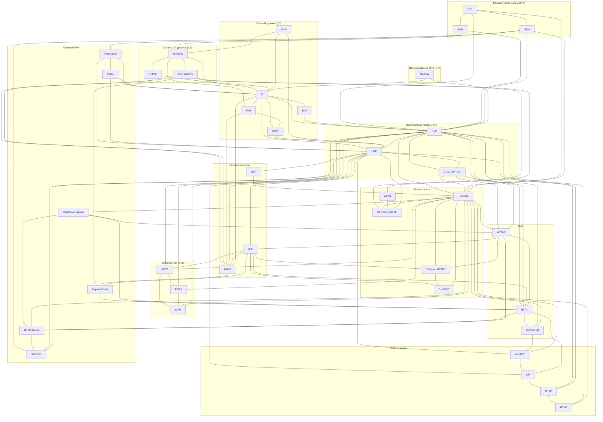

# Карта связей между протоколами

Протоколы не работают поодиночке: они вкладываются друг в друга (стек) и дополняют друг друга. Ниже — общая схема (GitHub отрисует её автоматически) и типичные цепочки.

## Типичные цепочки протоколов
| Сценарий | Цепочка |
|----------|---------|
| Открытие сайта | Ethernet/Wi-Fi → IP → UDP → DNS, затем IP → TCP → TLS → HTTP |
| Современный сайт | IP → UDP → QUIC (встроенный TLS 1.3) → HTTP/3 |
| Отправка письма | TCP → TLS → SMTP (сервер получателя ищется по MX-записи DNS) |
| Видеозвонок в браузере | сигнализация через WebSocket/HTTPS, затем UDP → DTLS → SRTP (WebRTC) |
| Подключение к Wi-Fi дома | Wi-Fi (WPA2/WPA3) → DHCP (адрес) → DNS |
| Подключение к Wi-Fi в офисе | Wi-Fi → 802.1X/EAP → RADIUS → 4-стороннее рукопожатие → DHCP |
| Wi-Fi в кафе | Wi-Fi → DHCP → проверочный HTTP-запрос → Captive Portal |
| Удалённая работа | IP → UDP → WireGuard/IPsec (туннель) → корпоративная сеть |
| Выход домашнего роутера в интернет | Ethernet → PPPoE (вход, публичный IP) → IP → BGP-маршруты провайдеров |

## Кто на чём работает
| Транспорт | Протоколы |
|-----------|-----------|
| TCP | HTTP, HTTPS, WebSocket, TLS, SMTP, POP3, IMAP, FTP, SMB, SSH, RTSP (управление), RTMP, BGP, SOCKS5, HTTP-прокси, Modbus/TCP, DNS (для больших ответов) |
| UDP | DNS, DHCP, NTP, QUIC/HTTP3, WebRTC (медиа), SIP, RTP (голос и видео), WireGuard, IPsec (IKE), RADIUS |
| Прямо поверх IP | ICMP (протокол 1), IGMP (протокол 2), ESP в IPsec (протокол 50) |
| Ниже IP (канальный уровень) | Ethernet, Wi-Fi, WPA3, 802.1X, PPPoE |

## Пары «открытый — защищённый»
| Открытый | Защищённый вариант |
|----------|--------------------|
| HTTP | HTTPS, HTTP/3 (QUIC) |
| DNS | DNS over HTTPS (скрывает), DNSSEC (подтверждает подлинность) |
| FTP | SFTP (через SSH), FTPS |
| Wi-Fi WPA2 | WPA3, WPA2/3-Enterprise (802.1X + RADIUS) |
| SMTP / POP3 / IMAP | Те же протоколы поверх TLS (465, 995, 993) |
| RTMP | RTMPS |
| Modbus | Встроенной защиты нет — нужна изоляция сети |

---
[← К разделу «Основы»](../README.md)
